<a href="https://thepatelsuraj.dev">
  <picture>
    <source media="(prefers-color-scheme: dark)" srcset="assets/hero-dark.svg">
    <source media="(prefers-color-scheme: light)" srcset="assets/hero-light.svg">
    
  </picture>
</a>

  <a href="https://thepatelsuraj.dev"><b>thepatelsuraj.dev</b></a> &nbsp;·&nbsp;
  <a href="https://thepatelsuraj.dev/Suraj_Patel_Resume.pdf">Résumé</a> &nbsp;·&nbsp;
  <a href="https://linkedin.com/in/thepatelsuraj">LinkedIn</a> &nbsp;·&nbsp;
  <a href="mailto:23se02cs076@gmail.com">Email</a> &nbsp;·&nbsp;
  <a href="https://leetcode.com/u/sp9023156004">LeetCode</a>

Final-year B.Tech CSE student and DevOps/SRE intern who owns **two production systems end to end**: self-managed infrastructure, CI/CD with automatic rollback, security hardening, and encrypted backup and recovery. Outside work I build the other half of the stack — the pipeline that ships the code, the telemetry that tells you it broke, and the system that works out why.

 

<picture>
  <source media="(prefers-color-scheme: dark)" srcset="assets/section-numbers-dark.svg">
  <source media="(prefers-color-scheme: light)" srcset="assets/section-numbers-light.svg">
  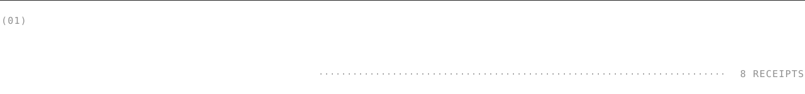
</picture>

<picture>
  <source media="(prefers-color-scheme: dark)" srcset="assets/numbers-dark.svg">
  <source media="(prefers-color-scheme: light)" srcset="assets/numbers-light.svg">
  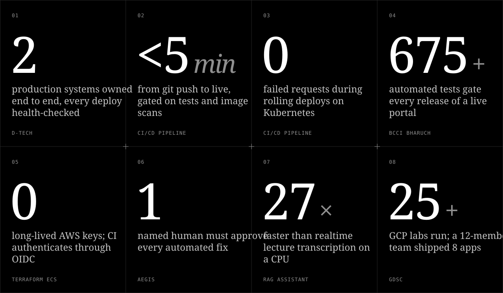
</picture>

  

<picture>
  <source media="(prefers-color-scheme: dark)" srcset="assets/section-work-dark.svg">
  <source media="(prefers-color-scheme: light)" srcset="assets/section-work-light.svg">
  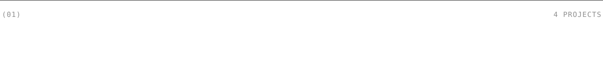
</picture>

<a href="https://github.com/underratedgitter/Aegis">
  <picture>
    <source media="(prefers-color-scheme: dark)" srcset="assets/work-aegis-dark.svg">
    <source media="(prefers-color-scheme: light)" srcset="assets/work-aegis-light.svg">
    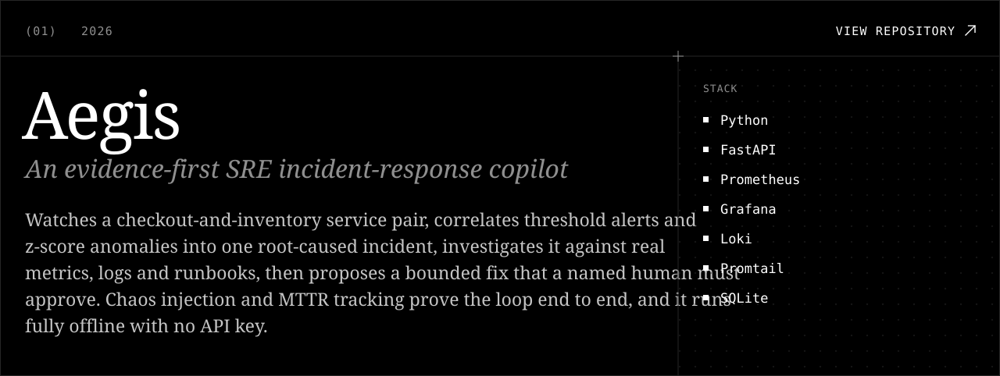
  </picture>
</a>

 

<a href="https://github.com/underratedgitter/CI-CD-Pipeline-Automation-with-Docker-Cloud-Deployment">
  <picture>
    <source media="(prefers-color-scheme: dark)" srcset="assets/work-cicd-dark.svg">
    <source media="(prefers-color-scheme: light)" srcset="assets/work-cicd-light.svg">
    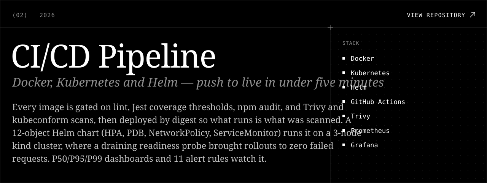
  </picture>
</a>

 

<a href="https://github.com/underratedgitter/terraform-aws-ecs-platform">
  <picture>
    <source media="(prefers-color-scheme: dark)" srcset="assets/work-terraform-dark.svg">
    <source media="(prefers-color-scheme: light)" srcset="assets/work-terraform-light.svg">
    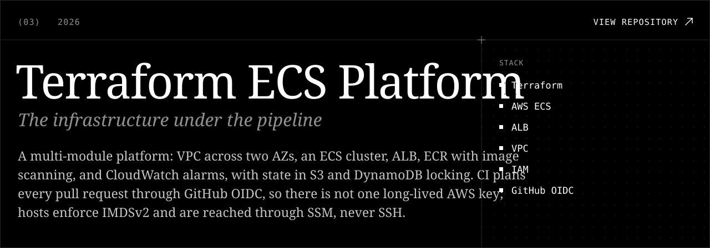
  </picture>
</a>

 

<a href="https://github.com/underratedgitter/RAG-teaching-assistant">
  <picture>
    <source media="(prefers-color-scheme: dark)" srcset="assets/work-rag-dark.svg">
    <source media="(prefers-color-scheme: light)" srcset="assets/work-rag-light.svg">
    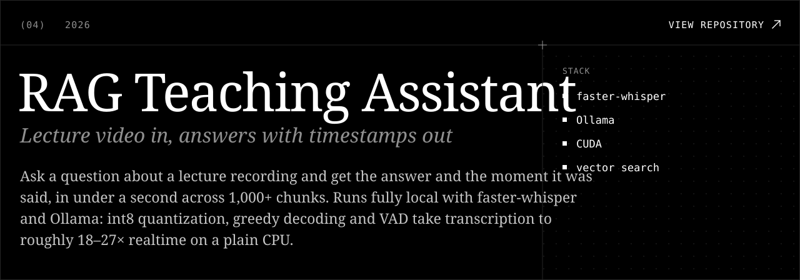
  </picture>
</a>

  

<picture>
  <source media="(prefers-color-scheme: dark)" srcset="assets/section-experience-dark.svg">
  <source media="(prefers-color-scheme: light)" srcset="assets/section-experience-light.svg">
  
</picture>

<picture>
  <source media="(prefers-color-scheme: dark)" srcset="assets/experience-dark.svg">
  <source media="(prefers-color-scheme: light)" srcset="assets/experience-light.svg">
  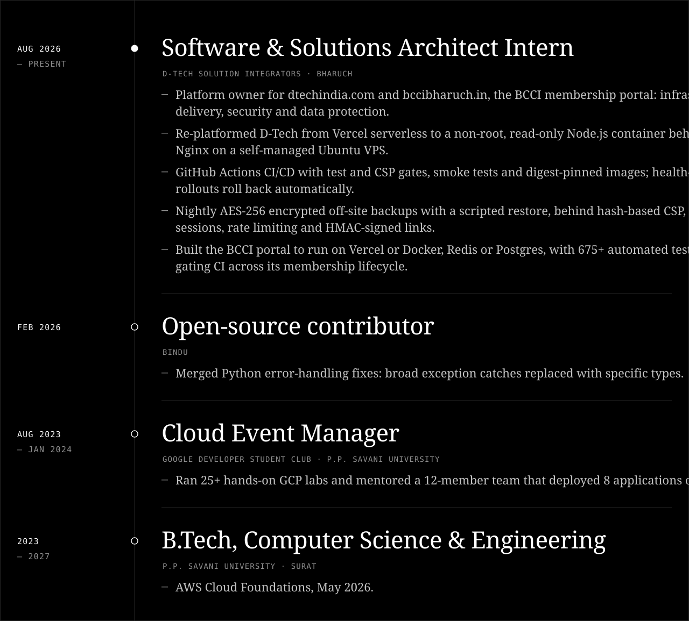
</picture>

Live systems: <a href="https://dtechindia.com">dtechindia.com</a> · <a href="https://bccibharuch.in">bccibharuch.in</a> &nbsp;—&nbsp; open source: <a href="https://github.com/GetBindu/Bindu">GetBindu/Bindu</a>

  

<picture>
  <source media="(prefers-color-scheme: dark)" srcset="assets/section-toolkit-dark.svg">
  <source media="(prefers-color-scheme: light)" srcset="assets/section-toolkit-light.svg">
  
</picture>

<picture>
  <source media="(prefers-color-scheme: dark)" srcset="assets/toolkit-dark.svg">
  <source media="(prefers-color-scheme: light)" srcset="assets/toolkit-light.svg">
  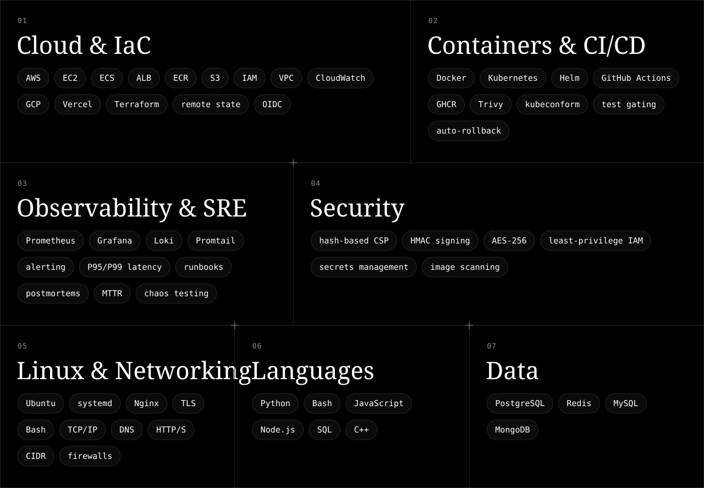
</picture>

  

<a href="https://thepatelsuraj.dev">
  <picture>
    <source media="(prefers-color-scheme: dark)" srcset="assets/contact-dark.svg">
    <source media="(prefers-color-scheme: light)" srcset="assets/contact-light.svg">
    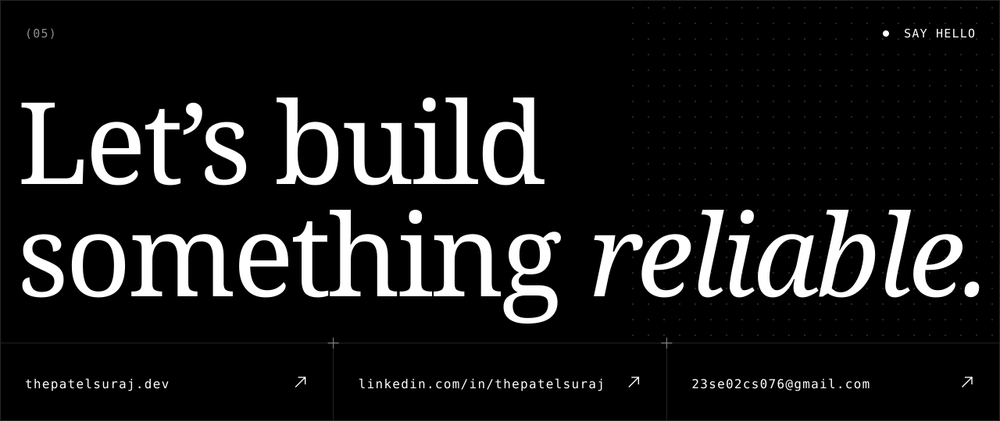
  </picture>
</a>

Open to DevOps, cloud and SRE roles, including onsite in Surat — <a href="mailto:23se02cs076@gmail.com">23se02cs076@gmail.com</a> Set in Instrument Serif and Geist Mono (SIL Open Font License)

