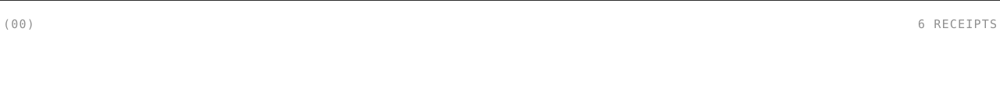
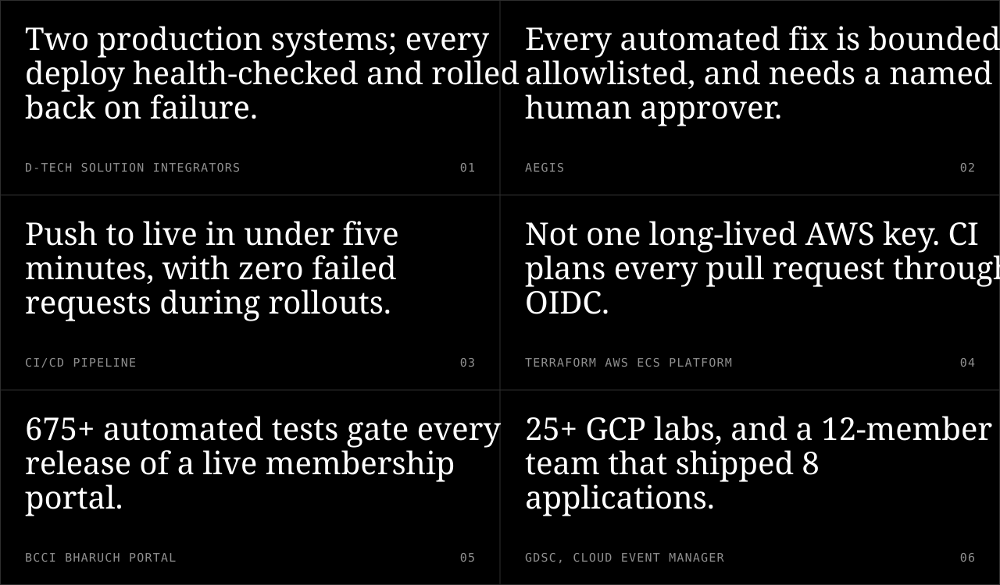
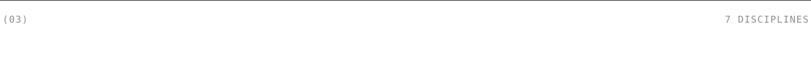

<a href="https://thepatelsuraj.dev">
  <picture>
    <source media="(prefers-color-scheme: dark)" srcset="assets/hero-dark.svg">
    <source media="(prefers-color-scheme: light)" srcset="assets/hero-light.svg">
    
  </picture>
</a>

**[thepatelsuraj.dev](https://thepatelsuraj.dev)** &nbsp;·&nbsp; [Résumé](https://thepatelsuraj.dev/Suraj_Patel_Resume.pdf) &nbsp;·&nbsp; [LinkedIn](https://linkedin.com/in/thepatelsuraj) &nbsp;·&nbsp; [Email](mailto:23se02cs076@gmail.com) &nbsp;·&nbsp; [LeetCode](https://leetcode.com/u/sp9023156004)

Final-year B.Tech CSE student and DevOps/SRE intern who owns **two production systems end to end**: self-managed infrastructure, CI/CD with automatic rollback, security hardening, and encrypted backup and recovery. Outside work I build the other half of the stack — the pipeline that ships the code, the telemetry that tells you it broke, and the system that works out why.

 

<picture>
  <source media="(prefers-color-scheme: dark)" srcset="assets/section-receipts-dark.svg">
  <source media="(prefers-color-scheme: light)" srcset="assets/section-receipts-light.svg">
  
</picture>

<picture>
  <source media="(prefers-color-scheme: dark)" srcset="assets/receipts-dark.svg">
  <source media="(prefers-color-scheme: light)" srcset="assets/receipts-light.svg">
  
</picture>

  

<picture>
  <source media="(prefers-color-scheme: dark)" srcset="assets/section-work-dark.svg">
  <source media="(prefers-color-scheme: light)" srcset="assets/section-work-light.svg">
  
</picture>

### [Aegis ↗](https://github.com/underratedgitter/Aegis)
`2026` &nbsp;·&nbsp; EVIDENCE-FIRST SRE INCIDENT-RESPONSE COPILOT

Watches a checkout-and-inventory service pair, correlates threshold alerts and z-score anomalies into **one root-caused incident**, investigates it against real metrics, logs and runbooks, then proposes a bounded fix that a named human must approve. Chaos injection and MTTR tracking prove the loop end to end, and it runs fully offline with no API key.

`Python` `FastAPI` `Prometheus` `Grafana` `Loki` `Promtail` `SQLite`

### [CI/CD Pipeline with Docker, Kubernetes & Helm ↗](https://github.com/underratedgitter/CI-CD-Pipeline-Automation-with-Docker-Cloud-Deployment)
`2026` &nbsp;·&nbsp; PUSH TO LIVE IN UNDER FIVE MINUTES

Every image is gated on lint, Jest coverage thresholds, npm audit, and Trivy and kubeconform scans, then deployed by digest so what runs is what was scanned. A 12-object Helm chart (HPA, PDB, NetworkPolicy, ServiceMonitor) runs it on a 3-node kind cluster, where a draining readiness probe brought rollouts to **zero failed requests**. P50/P95/P99 dashboards and 11 alert rules watch it.

`Docker` `Kubernetes` `Helm` `GitHub Actions` `Trivy` `Prometheus` `Grafana`

### [Terraform AWS ECS Platform ↗](https://github.com/underratedgitter/terraform-aws-ecs-platform)
`2026` &nbsp;·&nbsp; THE INFRASTRUCTURE UNDER THE PIPELINE

A multi-module platform: VPC across two AZs, an ECS cluster, ALB, ECR with image scanning, and CloudWatch alarms, with state in S3 and DynamoDB locking. CI plans every pull request through GitHub OIDC, so there is **not one long-lived AWS key**; hosts enforce IMDSv2 and are reached through SSM, never SSH.

`Terraform` `AWS ECS` `ALB` `VPC` `IAM` `GitHub OIDC`

### [RAG Teaching Assistant ↗](https://github.com/underratedgitter/RAG-teaching-assistant)
`2026` &nbsp;·&nbsp; LECTURE VIDEO IN, ANSWERS WITH TIMESTAMPS OUT

Ask a question about a lecture recording and get the answer *and* the moment it was said, in under a second across 1,000+ chunks. Runs fully local with faster-whisper and Ollama: int8 quantization, greedy decoding and VAD take transcription to roughly **18–27× realtime on a plain CPU**.

`faster-whisper` `Ollama` `CUDA` `vector search`

 

<picture>
  <source media="(prefers-color-scheme: dark)" srcset="assets/section-experience-dark.svg">
  <source media="(prefers-color-scheme: light)" srcset="assets/section-experience-light.svg">
  
</picture>

**Software & Solutions Architect Intern** — [D-Tech Solution Integrators](https://dtechindia.com), Bharuch &nbsp;`AUG 2026 — NOW`
- Platform owner for [dtechindia.com](https://dtechindia.com) and [bccibharuch.in](https://bccibharuch.in), the BCCI membership portal: infrastructure, delivery, security and data protection.
- Re-platformed D-Tech from Vercel serverless to a non-root, read-only Node.js container behind Nginx on a self-managed Ubuntu VPS.
- GitHub Actions CI/CD with test and CSP gates, smoke tests and digest-pinned images; health-checked rollouts **roll back automatically**.
- Nightly **AES-256 encrypted off-site backups** with a scripted restore, and a security baseline of hash-based CSP, strict sessions, rate limiting and HMAC-signed expiring links.
- Built the BCCI portal to run on Vercel or Docker, Redis or Postgres, with **675+ automated tests** gating CI across its whole membership lifecycle.

**Cloud Event Manager** — Google Developer Student Club, P.P. Savani University &nbsp;`AUG 2023 — JAN 2024`
- Ran 25+ hands-on GCP labs and mentored a 12-member team that deployed 8 applications on GCP.

**Open source** — [Bindu](https://github.com/GetBindu/Bindu) &nbsp;`FEB 2026`
- Merged Python error-handling fixes: broad exception catches replaced with specific types.

**B.Tech, Computer Science & Engineering** — P.P. Savani University, Surat &nbsp;`2023 — 2027`
- AWS Cloud Foundations (May 2026)

 

<picture>
  <source media="(prefers-color-scheme: dark)" srcset="assets/section-toolkit-dark.svg">
  <source media="(prefers-color-scheme: light)" srcset="assets/section-toolkit-light.svg">
  
</picture>

<picture>
  <source media="(prefers-color-scheme: dark)" srcset="assets/toolkit-dark.svg">
  <source media="(prefers-color-scheme: light)" srcset="assets/toolkit-light.svg">
  
</picture>

  

<a href="https://thepatelsuraj.dev">
  <picture>
    <source media="(prefers-color-scheme: dark)" srcset="assets/contact-dark.svg">
    <source media="(prefers-color-scheme: light)" srcset="assets/contact-light.svg">
    
  </picture>
</a>

Open to DevOps, cloud and SRE roles, including onsite in Surat — <a href="mailto:23se02cs076@gmail.com">23se02cs076@gmail.com</a>. Set in Instrument Serif and Geist Mono (SIL Open Font License).
